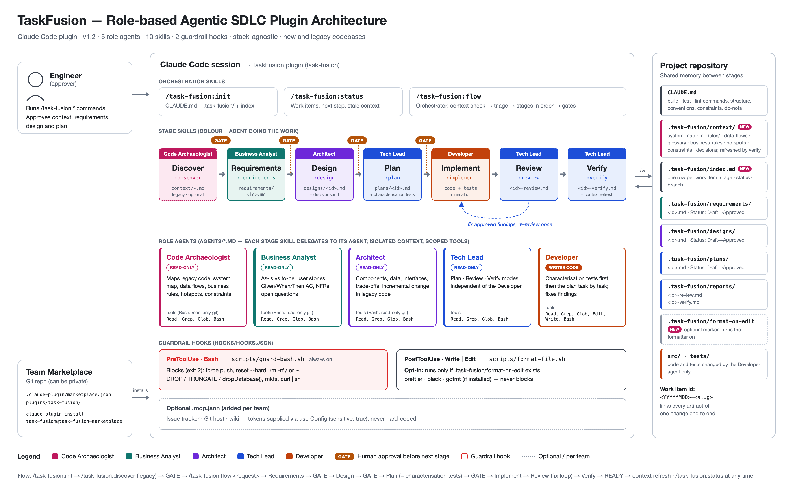

# TaskFusion

TaskFusion is a Claude Code plugin that packages a role-based agentic SDLC into one installable unit. Five specialist agents (Business Analyst, Architect, Tech Lead, Developer and Code Archaeologist) take a change from request to verified code. Each stage writes an artifact to the repository, and a human approves it before the next stage starts. The plugin is stack-agnostic and works on new and legacy codebases alike.



## Install

This repository is a Claude Code plugin marketplace. You need access to the repository, plus Claude Code, git, jq and bash.

```
claude plugin marketplace add nipunadeesarakarunatilleke/TaskFusion
claude plugin install task-fusion@task-fusion-marketplace
```

To try it without installing, start Claude Code with the plugin loaded:

```
claude --plugin-dir ./task-fusion-marketplace/plugins/task-fusion
```

## Quick start

In the repository you want to work on:

```
/task-fusion:init                 # writes CLAUDE.md and .task-fusion/
/task-fusion:discover             # existing or legacy codebase: maps it into .task-fusion/context/
/task-fusion:flow <request>       # requirements → design → plan → implement → review → verify
```

Each stage also has its own command (`/task-fusion:requirements`, `:design`, `:plan`, `:implement`, `:review`, `:verify`), and `/task-fusion:status` shows every work item, what it is waiting for, and any project context that has gone out of date.

Project knowledge is kept in the repository: `CLAUDE.md` for commands and conventions, `.task-fusion/context/` for system knowledge and the decision log, and one set of artifacts per change, tracked in `.task-fusion/index.md`. Commit `.task-fusion/` so the whole team works from the same picture.

## What's in the box

| Agent | Role | Writes code? |
|---|---|---|
| Code Archaeologist | Maps existing code: system map, data flows, business rules, hotspots and constraints | No |
| Business Analyst | User stories, Given/When/Then acceptance criteria, non-functional requirements | No |
| Architect | Components, data, interfaces, decisions and risks | No |
| Tech Lead | Plans the work, reviews the code and runs the final verification gate | No |
| Developer | Implements the approved plan and its tests | Yes |

Two guardrail hooks run automatically. One blocks destructive shell commands such as force pushes, `rm -rf /` and `DROP TABLE`. The other formats edited files, but only in projects that opt in with `.task-fusion/format-on-edit`.

See the [plugin README](task-fusion-marketplace/plugins/task-fusion/README.md) for the full workflow, the guardrails and how to customise them.

## Repository layout

| Path | Contents |
|---|---|
| `.claude-plugin/marketplace.json` | Marketplace manifest used when you add this repository |
| `task-fusion-marketplace/` | The marketplace and the `task-fusion` plugin (skills, agents, hooks, scripts) |
| `TaskFusion-Architecture.png` | Architecture diagram |
| `docs/architecture.html` | Source for the diagram, with the command to re-render it |

## Releasing a new version

Bump `version` in `task-fusion-marketplace/plugins/task-fusion/.claude-plugin/plugin.json` and push. Installed users stay on their current version until the version number changes.
